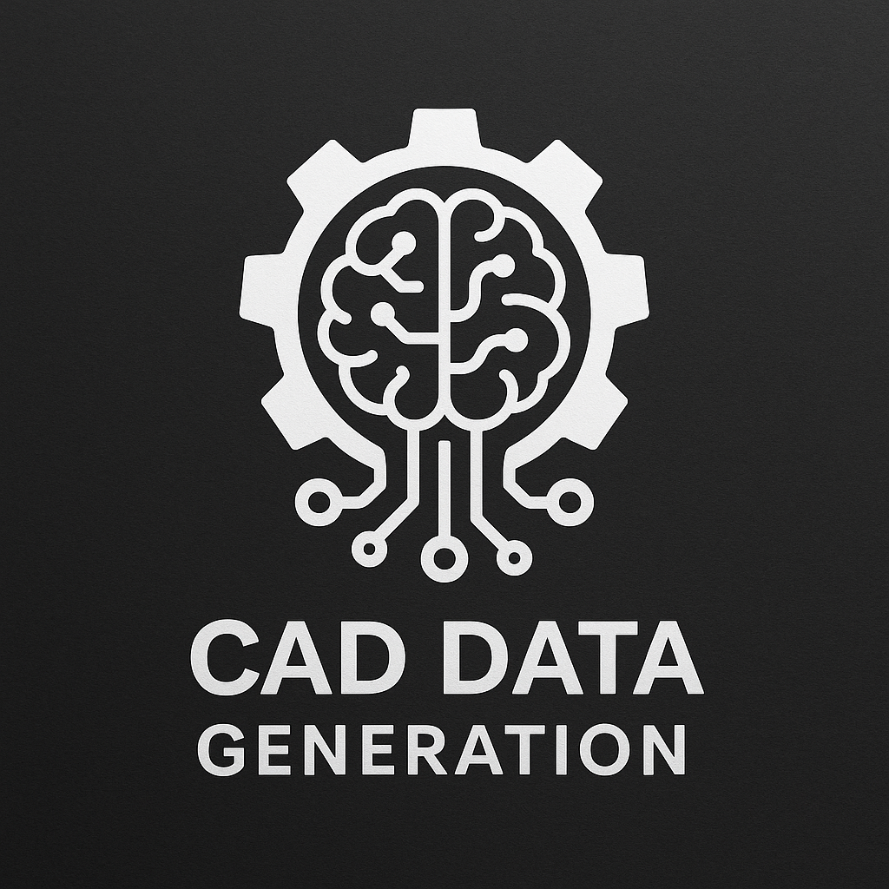

# CAD Environment: verified FreeCAD data for LLM / VLM agents

Окружение FreeCAD и фабрика проверенных обучающих траекторий для **SFT, preference learning и online GRPO**. Новый контур `cad_env.agent` / `cad_env.learning` строит настоящие параметрические детали и проверяет геометрию. Mock не используется для положительных labels.

Практический процесс для **двух GPU по 24 GB**, агента через API/tools и текущего визуального состояния: [TRAINING_PROCESS.md](docs/TRAINING_PROCESS.md). В нём закреплены зависимости, проверки данных и награды, SFT, оценка на отложенных задачах и условия перехода к multi-turn GRPO. Проверенный SFT-контур и экспериментальная RL-интеграция имеют отдельные статусы.

Проверен и [полный SFT-запуск на одной RTX 3090 GPU 1](docs/GPU1_EXPERIMENT.md): 912 сгенерированных задач, 200 шагов обучения, рост CAD reward с 0 до 1 на фиксированном ограниченном validation. В отчёте приведены checkpoints, память и ограничения результата.

[Эксперимент Qwen3.5-4B](docs/QWEN35_EXPERIMENT.md): отдельный закреплённый стек, исправленный single-action prompt, рост strict success с 46/69 до 69/69 после SFT. State-only контроль тоже получил 69/69: текущий benchmark не демонстрирует необходимость изображений. В отчёте описан конфликт старой инструкции; исторический baseline выше нельзя напрямую сравнивать с новым контрактом.

[Визуальный curriculum и критерии доказательства](docs/VISUAL_CAD_CURRICULUM.md): задачи с одинаковыми текстом и геометрией, где цель определяется картинкой, сложные построения по чертежам, проверки без картинки и с подменённой целью. Первый новый SFT-пилот дал 1/100 → 12/100; этого недостаточно для утверждения о качественном скачке. Отчёт отделяет измеренные результаты от следующих экспериментов.



## Запуск

Нужны Python ≥3.10 и отдельно установленный FreeCAD console. Проверена сборка FreeCAD 1.1.0, revision 43087, OCCT 7.8.1. Закрепляйте точную сборку при сравнении результатов.

```bash
pip install -e '.[data,api,dev]'
export FREECAD_CMD=/usr/bin/freecadcmd-daily  # либо ваш FreeCADCmd/freecadcmd
python -m cad_env.learning.cli doctor
python -m cad_env.learning.cli generate \
  --output artifacts/dataset-v1 --seeds 100 --workers 4 \
  --preferences --holdout-families flange
```

Без рендера фабрика требует только стандартную библиотеку Python и внешний FreeCAD: `pip install -e .`, затем `generate --no-render`. Для изображений нужны NumPy/Pillow из extra `data`.

## Реализовано

- Четыре семейства: пластина, втулка, фланец, ступенчатый вал.
- Создание, изменение размера и исправление неверного размера.
- Ограниченный JSON-язык: Body, прямоугольный/круговой Sketch, Pad, Pocket, изменение constraint, finish.
- Реальное исполнение в отдельном процессе; save/reopen FCStd, таймаут, сохранение диагностики и checkpoints.
- Проверка валидности solid, OCCT symmetric difference, независимых аналитических объёма/габаритов, параметричности и сохранения истории.
- Пошаговый `reset/step`: неудачные действия не портят committed state.
- Четыре вида геометрии с Z-buffer и метаданными камеры для VLM.
- JSONL экспорты: whole-program SFT, next-action SFT, VLM, GRPO prompts и preference pairs.
- Группировка splits по происхождению/base design, дедупликация, optional holdout целого семейства.
- TRL reward callback, SFT/GRPO launchers, sampling модели с rejection-SFT и mining preference пар.
- Multi-turn rollout collector для восстановления после ошибок; локальный HTTP transport.

## Обучение

Тяжёлые ML-зависимости отделены от CAD worker. Используйте отдельное окружение с `requirements-learning.txt` и выбранный вами checkpoint:

```bash
python -m cad_env.learning.train --method sft \
  --model /path/to/code-model --dataset artifacts/dataset-v1 \
  --output artifacts/sft-run --max-steps 1000 --batch-size 2

python -m cad_env.learning.train --method grpo \
  --model /path/to/sft-checkpoint --dataset artifacts/dataset-v1 \
  --output artifacts/grpo-run --num-generations 4 --batch-size 4 \
  --cad-workers 2 --max-steps 100
```

SFT использует completion-only loss. Online GRPO получает свежие completions и оценивает каждую настоящим CAD worker. Предварительно посчитанные normalized advantages служат диагностикой, а не заменяют on-policy optimizer.

## Документация и проверки

- [Полное руководство: данные, reward, SFT/GRPO, sampling, API](docs/LEARNING_PIPELINE.md)
- [Исходное исследование архитектуры и датасетов](docs/FREECAD_AGENT_RESEARCH.md)

```bash
python -m pytest -q
uvicorn cad_env.agent.api:create_app --factory --host 127.0.0.1 --port 8000
```

Integration-тесты требуют настоящий FreeCAD и явно skipped при его отсутствии. Локальный HTTP-сервис выполняет native work последовательно в одном процессе; параллельная фабрика использует отдельные workers.

## Текущие границы

Это ограниченный, проверяемый baseline: четыре фиксированных структурных шаблона с вариациями размеров. VLM-данные содержат рендеры и текст размеров; GUI-действия и инженерные чертежи пока не записываются. GRPO launcher оценивает одну JSON-программу на completion; multi-turn GRPO с учётом log-probabilities ещё не реализован. Editability probe проверяет изменение хотя бы одного размера, а не все инженерные зависимости.

Старые `cad_env.core`, `llm_interface`, `code_generator` и `training` остаются legacy API. Их regex-шаблоны и `training_data/training_dataset.json` не используются новой фабрикой. Симуляция и exit code произвольного Python больше не считаются доказательством корректного CAD.

Apache 2.0.

## Optional Blender and CadQuery executors

The `cad_env.multicad` package adds native Blender and CadQuery execution next to
FreeCAD, with a shared restricted tool language, sequential `reset/step`,
procedural mechanical tasks, image-conditioned SFT exports, TRAIN-only native
reward hooks and held-out evaluation. See [multi-engine setup and commands](docs/MULTICAD.md)
and [external benchmark coverage](docs/BENCHMARK_COVERAGE.md). This does not
replace the frozen FreeCAD benchmark or claim full CADBench/CADWorld coverage.

Advanced native feature probes (arcs, revolves, fillets, chamfers, shells and
multiple solids) use a separate [solid-graph contract](docs/SOLIDCAD.md).

Аудит фактического GRPO, ограничений данных и нового эксперимента на 2000 шагов:
[GRPO and data scaling audit](docs/GRPO_AND_DATA_AUDIT.md).
Новый `python -m cad_env.learning.visual_scale --output <fresh-directory>`
генерирует визуальные задачи с 1–4 редактированиями и отдельным holdout на 5–6;
данные проходят нативную проверку и аудит информационной зависимости от картинок.

## Project website and batched validation

The self-contained website lives in [`web/`](web/README.md), with native TRAIN
mesh examples, interactive 3D inspection and recorded experiment evidence.
Run `python -m http.server 8000 --directory web` from the repository root.

Concurrent evaluation uses one greedy VLM and independent native CAD episodes:
`python -m cad_env.learning.batch_evaluate --help`. See
[batch validation measurements](docs/BATCHED_VALIDATION.md) for parity checks,
execution-profile limits and preserved sequential checkpoint-500 results.
